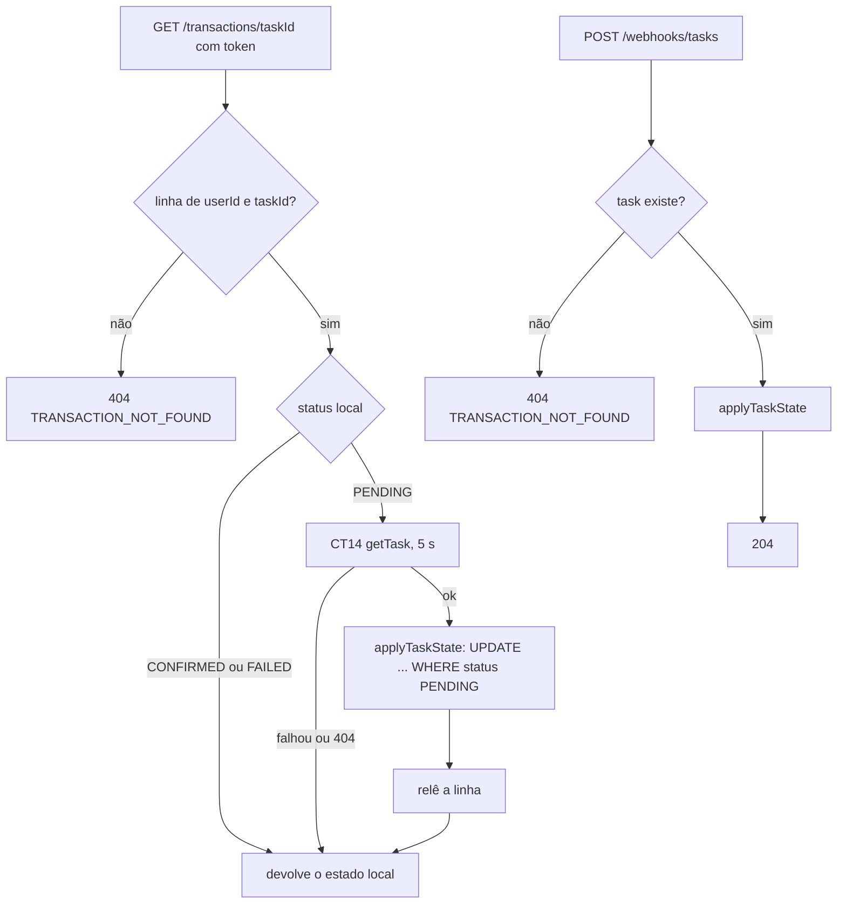

# Desenho do Core API (Container 2)

Escrito em 15/11/2026. As decisões 1 a 10 da seção 12 foram confirmadas pelo responsável do módulo (Igor) no mesmo dia. Fontes: `especificacao-entrega2.md` (fichas CT1, 2, 3, 6, 9, 12, 13, 15 e 17 são deste módulo), as fichas já emendadas do Blockchain Service (CT4, CT7, CT10, CT14, CT15) e a ficha CT18 do External Data Service. Em divergência, valem `docs/contratos/` e este desenho; a Especificação entregue não é emendada.

Legenda:
- **[Contrato]**: já definido na Especificação (CT, P). Só muda emendando a ficha.
- **[Sugestão]**: proposta deste documento, ainda não decidida.
- **[Aberto]**: decisão ainda não tomada.
- **[Decidido]**: decisão do responsável do módulo (Igor), com a data. Valem como decididas as 10 decisões da seção 12 (15/11/2026); as marcas [Sugestão] das seções 2 a 11 que correspondem a elas ficam subentendidas como decididas.

---

## 1. Papel e limites

O Core API é o ponto único de contato do Frontend. Ele:

1. Cadastra usuários e cria a carteira de cada um pelo Blockchain Service. [Contrato: CT1, CT2, CT4, P6]
2. Autentica por e-mail e senha e emite o token JWT. [Contrato: CT3, P1]
3. Valida o token em todas as rotas do Frontend, menos o cadastro e o login. [Contrato: P1]
4. Devolve o saldo da carteira do usuário. [Contrato: CT6, CT7]
5. Aceita pedidos de envio e guarda a cópia local da transação. [Contrato: CT9, CT10, CT12]
6. Responde ao polling do Frontend e mantém a cópia local em dia: pelo webhook e pela consulta ativa. [Contrato: CT13, CT14, CT15, P4]
7. Devolve preço e série de mercado, com rate limiting. [Contrato: CT17, CT18, P5]
8. Devolve o histórico da carteira do usuário, lido da blockchain pelo External Data Service (passo C10, fora da Especificação). [Contrato: CT26, CT24]

Ele **não**: fala com a Ethereum, guarda chave privada, chama a CoinGecko, nem decide o estado de uma transação (quem decide é o Blockchain Service; o Core API guarda uma cópia).

Premissa de implantação [Sugestão]: **uma única instância**. O contador do rate limiting fica em memória (seção 8.6) e só funciona assim. É a escolha mais simples para o projeto acadêmico.

## 2. Tecnologias

Mesma base do Blockchain Service, para a equipe ter um só jeito de trabalhar.

| Item | Escolha | Origem |
|---|---|---|
| Linguagem e build | Java 21, Maven | [Sugestão] igual ao Blockchain Service |
| HTTP | Javalin (mesma versão do Blockchain Service, 7.2.4) | [Contrato] Javalin |
| Banco e acesso | MySQL 8.4, Hibernate com `hibernate-hikaricp`, esquema em `schema.sql` e Hibernate em `validate` | [Contrato] Hibernate e MySQL; o resto [Sugestão] |
| JSON | Jackson | [Sugestão] |
| Cliente HTTP (Blockchain Service e External Data Service) | `java.net.http.HttpClient` do JDK | [Sugestão] |
| Hash de senha | bcrypt, biblioteca `at.favre.lib:bcrypt` (última versão 0.10.2, de fev/2023: estável, mas sem manutenção ativa) | [Sugestão] |
| JWT | HS256 com `com.auth0:java-jwt` (última versão 4.5.2, de abr/2026) | [Sugestão] |
| Rate limiting | Classe própria, sem biblioteca | [Sugestão] |
| Log e testes | SLF4J + Logback, JUnit 5 | [Sugestão] |
| Injeção de dependência | Nenhuma: montagem manual no `Main` | [Sugestão] |

Alternativas descartadas:
- **Hash de senha.** Argon2 (`argon2-jvm`) exige biblioteca nativa (JNA), um problema a mais no Docker. `jBCrypt` está abandonado. Spring Security Crypto traria o Spring só para isso. O exemplo do CT2 já mostra um hash bcrypt (`$2a$12$...`).
- **JWT.** `jjwt` funciona, mas são três artefatos. `java-jwt` é um só, usa o Jackson que já temos e tem verificação com algoritmo fixo. O exemplo de token da Especificação (`{"alg":"HS256"}`, `{"sub":"1"}`) é compatível com a escolha.
- **Rate limiting.** Bucket4j e Resilience4j resolvem problemas que não temos (várias instâncias, limites por chave). A classe própria tem cerca de 25 linhas e dá para explicar inteira à banca.

Versões exatas: o agente fixa no `pom.xml` na criação do projeto, na última estável compatível com o Java 21 (a do bcrypt e a do java-jwt acima são as que a pesquisa de 15/11 encontrou; confirmar no `mvn`).

## 3. Infraestrutura

### 3.1 Containers

| Serviço no compose | Imagem | Observação |
|---|---|---|
| `core-api` | build do repositório `-core-api` | Dockerfile multi-stage, usuário não root. Porta 8080 publicada em `127.0.0.1:8080` (o navegador do Frontend precisa alcançá-la) |
| `core-db` | MySQL 8.4, tag fixa | Volume nomeado. Porta **não** publicada |

O `core-api` só sobe depois do banco saudável (`depends_on` com `service_healthy`). Segredos em `.env` fora do git, com `.env.example` versionado [Contrato: H01.2].

### 3.2 Variáveis de ambiente

| Variável | Para quê | Exemplo |
|---|---|---|
| `SERVER_PORT` | Porta do Javalin | `8080` |
| `DB_URL`, `DB_USER`, `DB_PASSWORD` | Banco do Core API | `jdbc:mysql://core-db:3306/core` |
| `JWT_SECRET` | Segredo do HS256, mínimo 32 bytes (a subida falha se for menor, ou se for um valor de exemplo) | (segredo) |
| `JWT_TTL_MINUTES` | Validade do token | `240` |
| `SERVICE_KEY` | Chave compartilhada (P2): enviada ao Blockchain Service e exigida no webhook | (segredo; o mesmo valor do Blockchain Service) |
| `BLOCKCHAIN_SERVICE_URL` | Base do Blockchain Service | `http://blockchain-service:8081` |
| `EXTERNAL_DATA_SERVICE_URL` | Base do External Data Service | `http://external-data-service:8082` |
| `BLOCKCHAIN_TIMEOUT_SECONDS` | Tempo limite das chamadas ao Blockchain Service | `15` |
| `EXTERNAL_DATA_TIMEOUT_SECONDS` | Tempo limite das chamadas ao External Data Service | `15` |
| `MARKET_RATE_LIMIT_MAX` | Requisições ao CT17 por janela | `10` |
| `MARKET_RATE_LIMIT_WINDOW_SECONDS` | Tamanho da janela | `60` |
| `CORS_ALLOWED_ORIGIN` | Origem do Frontend | `http://localhost:5173` |
| `TASK_SOCKET_HOST` | Opcional: host do canal de socket do Blockchain Service (CT27) | `blockchain-service` (padrão) |
| `TASK_SOCKET_PORT` | Opcional: porta do canal de socket; `0` desativa | `9091` (padrão) |

O `Main` lê tudo em uma classe `AppConfig` e falha na subida se faltar variável, como no Blockchain Service. O `toString` da configuração não imprime segredos nem URLs.

Por que 15 s nos dois tempos: o CT7 do Blockchain Service pode esperar até 10 s pelo RPC, e o CT18 faz duas chamadas à CoinGecko em sequência. O Core API precisa esperar mais do que eles, senão devolve 502 quando o outro módulo ainda ia responder.

### 3.3 Rede em desenvolvimento [Decidido]

Cada módulo tem o seu compose de desenvolvimento, e o compose do sistema ainda não existe. O Core API precisa alcançar o Blockchain Service (já no cadastro, passo C2), e o webhook faz o caminho inverso (passo C6). Solução até o compose do sistema existir: uma rede Docker externa `lemma-dev` (`docker network create lemma-dev`, uma vez por máquina), declarada como `external` nos dois composes. O `blockchain-service` e o `core-api` entram nela **além** da rede padrão do próprio compose, que continua sendo a do banco; o banco de cada módulo **não** entra na `lemma-dev`. O Core API chama o Blockchain Service em `http://blockchain-service:8081`, e o Blockchain Service avisa o Core API em `http://core-api:8080/webhooks/tasks` (valor que o `.env.example` do Blockchain Service já traz).

Ajuste de 15/11/2026, decidido pelo responsável do módulo (Igor): a rede entra no passo **C2**, e não no C9 como estava no primeiro desenho, porque o cadastro real já precisa alcançar o Blockchain Service. A mudança no compose do Blockchain Service é um commit pequeno no repositório `-blockchain`, feito antes do C2.

## 4. Estrutura de código [Sugestão]

### 4.1 Pacotes

Base `com.lemma.core`. Mesmas camadas e mesmas regras de dependência do Blockchain Service (`controller → service → repository`, `service → client`; entidade não sai pelo JSON; validação no service; handler único de `ApiException`).

```
core/
  Main.java                       monta tudo e sobe o Javalin
  config/AppConfig.java
  controller/
    UserController.java           POST /users                      (CT1)
    AuthController.java           POST /auth/login                 (CT3)
    WalletController.java         GET /wallet/balance              (CT6)
    TransactionController.java    POST /transactions, GET /transactions/{taskId}   (CT9, CT13)
    WebhookController.java        POST /webhooks/tasks             (CT15)
    MarketController.java         GET /market/{assetId}            (CT17)
  dto/                            records de entrada e saída
  service/
    UserService.java              register (CT1)
    AuthService.java              login (CT3)
    WalletService.java            getBalance (CT6)
    TransactionService.java       send (CT9), get (CT13), applyTaskState (usado por CT13 e CT15)
    MarketService.java            getMarketData (CT17)
  repository/
    UserRepository.java           save, findById, findByEmail
    EthTransactionRepository.java save, findByTaskIdAndUserId, findByTaskId, updateIfPending
  model/                          User, EthTransaction, TransactionStatus, FailureReason
  client/
    BlockchainClient.java         interface: createWallet, getBalance, requestSubmission, getTask
    HttpBlockchainClient.java
    MarketDataClient.java         classe concreta: fetchMarketData
  security/
    PasswordHasher.java           bcrypt
    JwtService.java               emite e valida o token
    TokenFilter.java              exige o token e põe o userId no contexto
    ServiceKeyFilter.java         exige X-Service-Key (só no webhook)
  socket/
    Partner.java                  conexão com o servidor de socket (CT27)
    TaskNoticeListener.java       thread que assina e aplica os avisos (CT27 → regra do CT15)
  ratelimit/SlidingWindowRateLimiter.java
  exception/ApiException.java
```

### 4.2 Duas decisões para não cair em overengineering

1. **Uma interface de cliente, não duas.** `BlockchainClient` é interface porque os testes dos services (cadastro, envio, acompanhamento) precisam de um Blockchain Service falso, sem rede. `MarketDataClient` é classe concreta e é testado contra um servidor HTTP local do JDK, como o `CoreApiClient` do Blockchain Service. Services e repositories continuam sem interface.
2. **Cada método de repository abre e fecha a própria transação**, como no Blockchain Service. Nenhuma transação de banco fica aberta durante chamada a outro módulo.

## 5. Modelo de dados

Banco do Core API. Colunas em `snake_case`, tabelas no singular (P9). Campos de CT2 e CT12 [Contrato].

```sql
CREATE TABLE app_user (
  id               BIGINT       NOT NULL AUTO_INCREMENT PRIMARY KEY,
  email            VARCHAR(254) NOT NULL,
  password_hash    VARCHAR(100) NOT NULL,
  ethereum_address VARCHAR(42)  NOT NULL,
  created_at       DATETIME(3)  NOT NULL,
  CONSTRAINT uk_app_user_email   UNIQUE (email),
  CONSTRAINT uk_app_user_address UNIQUE (ethereum_address)
);

CREATE TABLE eth_transaction (
  task_id             CHAR(36)       NOT NULL PRIMARY KEY,   -- UUID do Blockchain Service
  user_id             BIGINT         NOT NULL,
  destination_address VARCHAR(42)    NOT NULL,
  amount_eth          DECIMAL(38,18) NOT NULL,
  status              VARCHAR(16)    NOT NULL,                -- PENDING | CONFIRMED | FAILED
  transaction_hash    VARCHAR(66)    NULL,
  failure_reason      VARCHAR(32)    NULL,                    -- REJECTED_BY_NETWORK | TRANSACTION_REVERTED | INTERNAL_ERROR
  created_at          DATETIME(3)    NOT NULL,
  updated_at          DATETIME(3)    NOT NULL,
  CONSTRAINT fk_eth_transaction_user FOREIGN KEY (user_id) REFERENCES app_user (id)
);
```

- A única restrição além das fichas é `uk_app_user_address` [Sugestão]: uma carteira pertence a um só usuário. É uma proteção barata contra dado inconsistente.
- **E-mail:** normalizado antes de gravar e de buscar (`trim` e minúsculas com `Locale.ROOT`), no máximo 254 caracteres. A unicidade real é a do banco (corrida entre dois cadastros, seção 8.1).
- **Endereços:** `ethereum_address` é gravado como o Blockchain Service devolve (formato com checksum). `destination_address` é gravado como o usuário enviou, depois de o Blockchain Service aceitá-lo. O Core API não calcula checksum (seção 6, "Validações").
- Valores sempre `BigDecimal`, serializados com `toPlainString()`. Datas em UTC (`Instant`, `hibernate.jdbc.time_zone=UTC`).
- `transaction_hash` guarda o que o Blockchain Service informou no momento. Com a emenda do CT14, o hash pode aparecer com a task ainda `PENDING` e sumir se a rede recusar. O Core API não trata o hash como definitivo enquanto a transação estiver `PENDING`.

## 6. Métodos expostos

| Contrato | Rota | Autenticação | Sucesso |
|---|---|---|---|
| CT1 `registerUser` | `POST /users` | nenhuma | 201 `{userId, email, ethereumAddress}` |
| CT3 `authenticateUser` | `POST /auth/login` | nenhuma | 200 `{token, expiresAt}` |
| CT6 `getBalance` | `GET /wallet/balance` | token | 200 `{ethereumAddress, balanceEth, network}` |
| CT9 `sendTransaction` | `POST /transactions` | token | 202 `{taskId, status: PENDING}` |
| CT13 `getTransaction` | `GET /transactions/{taskId}` | token | 200 `{taskId, status, destinationAddress, amountEth, transactionHash?, failureReason?, updatedAt}` |
| CT15 `notifyTaskCompleted` | `POST /webhooks/tasks` | `X-Service-Key` | 204 sem corpo |
| CT17 `getMarketData` | `GET /market/{assetId}` | token | 200 `{assetId, currency, currentPrice, series}` |
| CT26 `getWalletTransactions` | `GET /wallet/transactions` | token | 200 `{ethereumAddress, network, transactions}` |

Três grupos de rota, e cada um tem o seu filtro [Sugestão]:
- **Públicas:** `POST /users` e `POST /auth/login`.
- **Com token:** as demais do Frontend. `TokenFilter` valida o `Authorization: Bearer`, põe o `userId` no contexto da requisição e responde 401 `TOKEN_INVALID` se faltar, estiver inválido ou vencido.
- **Entre serviços:** `POST /webhooks/tasks`, com `X-Service-Key` comparado em tempo constante (`MessageDigest.isEqual`). **Não** usa token: o webhook vem do Blockchain Service. A premissa P1 diz "todas as rotas exigem token, exceto cadastro e login"; este desenho a lê como "todas as rotas **do Frontend**", e o CT15 já define a chave de serviço.

Pegadinha de implementação: o **CORS** precisa ser tratado antes do `TokenFilter`. O navegador faz uma pré-requisição `OPTIONS` sem o cabeçalho `Authorization`; se o filtro de token a barrar, o Frontend nunca consegue chamar nada. A origem permitida vem de `CORS_ALLOWED_ORIGIN`. CORS é controle de origem do navegador, não autenticação (Proposta, seção 3).

### Validações (no service)

- **E-mail** (CT1): obrigatório, formato simples (`^[^@\s]+@[^@\s]+\.[^@\s]+$`), no máximo 254 caracteres → `EMAIL_INVALID`. Sem validação sofisticada: a prova de que o e-mail existe não é requisito.
- **Senha** (CT1): obrigatória, no mínimo 8 caracteres e **no máximo 72 bytes em UTF-8** → `PASSWORD_INVALID`. O limite de 72 vem do bcrypt, que ignora o que passa disso; a biblioteca é configurada para **recusar** (não truncar em silêncio). É uma emenda ao CT1 (seção 12).
- **Corpo** (CT1, CT3, CT9): ausente, JSON malformado ou campo com tipo errado → 400 `REQUEST_INVALID`. O CT3 e o CT15 já usam esse código; CT1 e CT9 passam a usar (emenda). Campo ausente continua com o código do próprio campo.
- **Endereço de destino** (CT9): o Core API confere só o formato `^0x[0-9a-fA-F]{40}$`. A regra completa (checksum EIP-55 em caixa mista) fica **no Blockchain Service**, uma vez só, e o Core API repassa o 400 `ADDRESS_INVALID` que ele devolver. Assim o Core API não precisa de biblioteca de Keccak.
- **Valor** (CT9): `BigDecimal` maior que zero. O limite de 18 casas e 20 dígitos inteiros também fica no Blockchain Service (`AMOUNT_INVALID` repassado).
  - Ajuste de 15/11/2026, decidido pelo responsável do módulo (Igor): o Core API também confere o limite (maior que zero, até 18 casas e 20 dígitos inteiros, zeros à direita não contam) antes de chamar o CT10, porque a coluna `DECIMAL(38,18)` não comporta mais que isso (descobrir depois do CT10 deixaria uma task sem registro local) e porque um `BigDecimal` como `1E+999999999` não pode virar texto plano. O Blockchain Service continua sendo a autoridade: o checksum do endereço segue só lá, e o `AMOUNT_INVALID` dele continua repassado. A decisão 4 da seção 12 não é reaberta.
- **`assetId`** (CT17): `^[a-z0-9-]{1,64}$`. Fora disso, 404 `ASSET_NOT_FOUND` **sem** chamar o External Data Service (evita `../` e afins no caminho da chamada).

## 7. Chamadas aos outros módulos

### 7.1 Blockchain Service (`HttpBlockchainClient`)

Toda chamada leva `X-Service-Key`. Tempo limite de conexão de 3 s e de resposta de `BLOCKCHAIN_TIMEOUT_SECONDS`. A consulta ativa do CT14 usa um tempo fixo de 5 s (constante), porque a falha dela é tolerada (seção 8.4).

Regra única de tradução de erros [Sugestão]: qualquer resposta que não seja a esperada (timeout, conexão recusada, 401, 404, 5xx, corpo ilegível) vira a falha do módulo que chamou.

| Quem chama | Chamada | Falha vira |
|---|---|---|
| CT1 | CT4 `POST /wallets` | 502 `WALLET_UNAVAILABLE` (usuário não gravado) |
| CT6 | CT7 `GET /wallets/{address}/balance` | 502 `BLOCKCHAIN_UNAVAILABLE` |
| CT9 | CT10 `POST /transactions` | 502 `BLOCKCHAIN_UNAVAILABLE`, **exceto** 400 `ADDRESS_INVALID` e 400 `AMOUNT_INVALID`, repassados com o mesmo código |
| CT13 | CT14 `GET /tasks/{taskId}` | nenhuma: devolve o estado local sem erro (CT13) |

O log traz só o contrato chamado e o `code` ou status devolvido (nunca o corpo, a `X-Service-Key` ou a URL). Um `SERVICE_KEY_INVALID` ou `WALLET_NOT_FOUND` vindo do Blockchain Service é erro de configuração ou de dado: vira o mesmo 502 para o usuário, mas com `ERROR` no log.

### 7.2 External Data Service (`MarketDataClient` e `AddressHistoryClient`)

`GET {EXTERNAL_DATA_SERVICE_URL}/market-data/{assetId}` (CT18), com `X-Service-Key`. Resposta 404 `ASSET_NOT_FOUND` → 404 igual; qualquer outra falha → 502 `MARKET_DATA_UNAVAILABLE`. O módulo ainda não tem responsável nem código: o Core API é desenvolvido contra um servidor falso (seção 11) e só se liga ao real depois.

Histórico da carteira (passo C10): `GET {EXTERNAL_DATA_SERVICE_URL}/addresses/{ethereumAddress}/transactions` (CT24), com `X-Service-Key`, pelo `AddressHistoryClient`: classe própria, no mesmo padrão do `MarketDataClient` (conexão de 3 s, resposta de `EXTERNAL_DATA_TIMEOUT_SECONDS`, uma tentativa), sem mexer no cliente do mercado. O endereço é o do `app_user` do token, como no saldo. Qualquer falha (status diferente de 200, tempo esgotado, corpo fora do formato) → 502 `HISTORY_UNAVAILABLE`; nunca lista parcial. Sem rate limiting no Core API: o External Data Service guarda o histórico por endereço durante 12 s, e o Blockscout aceita 180 requisições por minuto. Regras completas na ficha CT26.

## 8. Fluxos que exigem decisão

### 8.1 Cadastro (CT1)

Ordem [Contrato: P6, E1, E2]: validar → conferir se o e-mail existe → gerar o hash → CT4 (cria a carteira) → gravar o usuário → responder 201.

- Se a carteira falhar, nada é gravado: 502 `WALLET_UNAVAILABLE`.
- **Carteira órfã [Sugestão: aceitar]:** se o Core API falhar depois do CT4 e antes de gravar (banco fora, ou corrida em que o outro cadastro ganhou a unicidade do e-mail), sobra uma carteira sem dono no Blockchain Service. Ela não tem saldo e custa nada. O endereço vai ao log em `WARN` para ser rastreável. Evitar isso exigiria gravar o usuário antes (estado "sem carteira") e um passo de limpeza, o que não se justifica.
- **Corrida de e-mail:** a conferência prévia dá a resposta rápida (409), mas quem garante a unicidade é a restrição do banco. Violação de unicidade na gravação → 409 `EMAIL_ALREADY_REGISTERED`.
- O hash (bcrypt custo 12, ~250 ms) é gerado **depois** de a conferência do e-mail e **antes** do CT4, para não deixar uma carteira criada à espera do bcrypt.

### 8.2 Login e token (CT3)

- Lê o usuário por e-mail. Se o e-mail não existe, **compara a senha contra um hash falso fixo** e responde igual: sem isso, o tempo de resposta (o bcrypt só roda quando o usuário existe) revela quais e-mails estão cadastrados, e o CT3 pede justamente o contrário.
- Token JWT HS256: `sub` = `userId` (texto), `iat`, `exp`; sem mais dados. O `expiresAt` da resposta é o `exp` em ISO 8601 UTC. Validade de `JWT_TTL_MINUTES` (o exemplo da Especificação sugere 4 h).
- A validação **fixa** o algoritmo (HS256) e confere a assinatura e o `exp`; um token com `alg: none` ou assinado com outro algoritmo é recusado. O `userId` do `sub` é usado nas rotas; se o usuário não existir mais, a rota responde 401 `TOKEN_INVALID`.
- Sem refresh e sem logout no servidor: o Frontend descarta o token. Token vencido leva à tela de login.
- O token e a senha **nunca** vão ao log.

### 8.3 Envio (CT9)

Ordem [Contrato: E4]: token → validar → ler o usuário (origem = `ethereum_address`) → CT10 → gravar `eth_transaction` (`PENDING`) → 202.

**Janela de inconsistência (limitação conhecida):** o CT10 não tem idempotência. Se o Blockchain Service criar a task e a resposta se perder (timeout), ou se o banco do Core API falhar depois do CT10, existe uma task que **vai enviar a transação** sem que o Core API tenha registro dela. O usuário vê um erro e pode tentar de novo, gerando um segundo envio. Consequências e escolhas:
- O Core API **não repete** o `POST /transactions` automaticamente (já registrado no passo 5 do Blockchain Service).
- Um webhook de task desconhecida recebe 404 (seção 8.5), sem efeito.
- Fechar essa janela de verdade exige que o Core API gere o `taskId` e o mande no CT10, para o Blockchain Service tratar o reenvio como o mesmo pedido. Muda duas fichas e dois módulos. [Aberto: recomendo **aceitar** a limitação e registrá-la no relatório; é testnet, e a janela só abre com timeout ou queda do banco.]

### 8.4 Acompanhamento (CT13) e a regra de convergência

Há **dois caminhos** que atualizam a cópia local: o webhook (CT15) e a consulta ativa (CT14, dentro do CT13). Eles podem rodar ao mesmo tempo. Para os dois serem seguros, ambos passam pelo mesmo método, `TransactionService.applyTaskState(taskId, status, transactionHash, failureReason)`, que faz **uma atualização condicional no banco**:

```sql
UPDATE eth_transaction
   SET status = ?, transaction_hash = ?, failure_reason = ?, updated_at = ?
 WHERE task_id = ? AND status = 'PENDING'
```

- Estado final (`CONFIRMED` ou `FAILED`) **nunca regride nem muda**: a condição `status = 'PENDING'` garante isso no banco, sem leitura prévia e sem corrida entre os dois caminhos.
- Repetir a mesma notificação é seguro (a segunda atualização não encontra `PENDING` e não altera nada).
- Em `PENDING`, a atualização também grava o hash que a consulta ativa trouxe (o usuário pode ver o link do explorador antes da confirmação); se a rede recusar, o estado final apaga o hash.



- A leitura sempre filtra por `taskId` **e** `userId`: a transação de outro usuário responde 404, igual à inexistente (CT13). Sem isso, qualquer usuário autenticado leria as transações dos outros.
- Se o CT14 falhar (rede, 5xx, 404), o CT13 devolve o último estado local, com aviso no log e sem erro. A cada polling a consulta se repete; é por isso que o webhook perdido não trava ninguém.
- A resposta do CT13 é montada **depois** da atualização, relendo a linha, para o Frontend nunca ver um estado mais antigo do que o que acabou de ser gravado.
- O `updatedAt` devolvido é o da linha local.
- Carga: o CT14 do Blockchain Service só lê o banco dele (sem RPC), então um polling de poucos segundos por transação pendente é barato.

### 8.5 Webhook (CT15)

`POST /webhooks/tasks`, com `X-Service-Key`. Validação do corpo: `taskId`, `status` (`CONFIRMED` ou `FAILED`) e `updatedAt` obrigatórios; `failureReason` obrigatório quando `FAILED`; qualquer falha → 400 `REQUEST_INVALID`. Task desconhecida → 404 `TRANSACTION_NOT_FOUND` (o Blockchain Service só registra em log; a corrida em que o aviso chega antes do `INSERT` do CT9 se resolve pelo CT13). Task conhecida → `applyTaskState` e **sempre 204**, tenha alterado algo ou não (reenvio seguro, ficha CT15). Notificação que contradiz um estado final já gravado (por exemplo `FAILED` sobre `CONFIRMED`) não altera nada, e vai ao log em `WARN`: não deveria existir.

O Blockchain Service avisa em **toda** transição final, inclusive `FAILED` sem `transactionHash` (`REJECTED_BY_NETWORK` e `INTERNAL_ERROR`). O receptor tem de aceitar isso. Essa é a versão emendada do CT15 que existe hoje só no repositório `-blockchain` (passo 7 de lá): a ficha do dono (este repositório) precisa receber a mesma emenda no passo C6.

### 8.5.1 Aviso também por socket (CT27, H08.2)

Além do webhook, que continua igual, o Core API recebe o aviso de task concluída por um canal de Socket TCP com serialização de objetos Java (ADR 0008 e CT27, no repositório do Blockchain Service), no modelo do exemplo do professor. O Blockchain Service é o "Servidor" e o Core API é o "Cliente": uma thread daemon (`task-notice-listener`) conecta em `TASK_SOCKET_HOST:TASK_SOCKET_PORT`, cria o `ObjectOutputStream` antes do `ObjectInputStream`, envia `SubscribeRequest` com a `SERVICE_KEY` e fica lendo. Cada `TaskCompletedNotice` vira um `TaskCompletedRequest` e passa por `TransactionService.notifyTaskCompleted`, a mesma chamada do `WebhookController`: mesma validação e mesma regra de convergência. O que no webhook seria 400 ou 404 aqui é ignorado com `WARN` (só `taskId`, `status` e o código), sem derrubar a thread. `ShutdownNotice` ou qualquer queda: fecha, espera 5 s e reconecta; o `WARN` de indisponível sai uma vez por queda. Sem ack: o que se perder com o canal fora do ar é recuperado pelo webhook ou pelo CT13. As quatro mensagens (`com.lemma.socket`) são cópias idênticas das do Blockchain Service.

| Exemplo do professor (cliente) | Lemma (Core API) |
|---|---|
| `Comunicado` | `com.lemma.socket.Message` |
| `ComunicadoDeDesligamento` | `com.lemma.socket.ShutdownNotice` |
| (pedidos do cliente) | `com.lemma.socket.SubscribeRequest` |
| `Resultado` | `com.lemma.socket.TaskCompletedNotice` |
| `Parceiro` | `com.lemma.core.socket.Partner` |
| `TratadoraDeComunicadoDeDesligamento` | `com.lemma.core.socket.TaskNoticeListener` |
| `Cliente` (abre o socket e os streams) | `TaskNoticeListener.run` e `Main.startTaskNoticeListener` |

Filtro de desserialização, aplicado logo depois de criar o `ObjectInputStream`: `maxdepth=5;com.lemma.socket.*;java.lang.String;!*`. **Sem `maxbytes` nem `maxrefs`**: o JDK conta esses limites no stream inteiro, e não por mensagem (o `reset()` do servidor não os zera); numa conexão longa, como esta, `maxbytes=4096` derrubaria o cliente depois de uns 10 avisos.

### 8.6 Mercado e rate limiting (CT17)

Ordem [Contrato: E6, E7]: token → `assetId` válido → **limite** → CT18.

- **Global, não por usuário [Sugestão].** O limite protege a cota da CoinGecko, que é da aplicação inteira. Um limite por usuário não protegeria nada.
- **Contado em requisições do CT17, não em chamadas à CoinGecko.** Cada requisição gera **duas** chamadas (CT19 e CT20). A documentação da CoinGecko dá o limite do plano Demo de formas diferentes: a página de limites atual fala em 100 chamadas por minuto; a página de erros comuns ainda diz "cerca de 30 por minuto, variando com o tráfego" (a premissa P5 usa 30). O desenho parte do número **mais conservador**. Com 30 chamadas por minuto, o teto seguro é de 15 requisições por minuto; o padrão é **10 por 60 s** (20 chamadas), com folga. Há também a cota mensal de 10.000 créditos do plano Demo (1 chamada = 1 crédito): 10 requisições por minuto são mais do que o teste de carga precisa, mas **um teste de carga repetido gasta créditos**. Os dois valores são configuração (`MARKET_RATE_LIMIT_MAX`, `MARKET_RATE_LIMIT_WINDOW_SECONDS`).
- **Janela deslizante com registro de instantes** (`ArrayDeque<Instant>` com `synchronized`): guarda no máximo `MAX` instantes; ao chegar uma requisição, descarta os mais antigos que a janela, e se ainda couberem, registra e deixa passar. Se não couber, o `Retry-After` é o tempo até o instante mais antigo sair da janela (arredondado para cima, mínimo 1). Escolhida em vez da janela fixa porque esta permite o dobro do limite na virada de janela, e o objetivo é justamente ficar abaixo do limite da CoinGecko. O relógio é injetável para teste.
- A requisição rejeitada **não** chama o External Data Service. Requisição aceita conta mesmo se o External Data Service falhar (a CoinGecko também conta erros 4xx e 5xx).
- Sem cache (Proposta, seção 4: não neste momento). Se a demonstração sofrer com o limite, um cache de alguns segundos por ativo é a opção mais simples. [Aberto, só se acontecer]

## 9. Segurança

- **Senha:** só o hash bcrypt (custo 12) vai ao banco. Nunca em log, resposta ou exceção.
- **JWT:** HS256, segredo de no mínimo 32 bytes em `JWT_SECRET`, algoritmo fixado na validação, sem dado sensível no token. Quem tiver o segredo emite token de qualquer usuário; por isso ele não vai ao repositório.
- **Chave de serviço:** comparação em tempo constante; nunca em log.
- **Enumeração de usuários:** o login responde igual e leva o mesmo tempo para e-mail inexistente e senha errada. O cadastro responde 409 para e-mail existente (é o contrato) e, portanto, revela que o e-mail está cadastrado; aceito.
- **Isolamento entre usuários:** toda leitura de transação filtra por `userId`; o saldo e o envio usam o endereço do usuário do token, nunca um endereço vindo do cliente.
- **Limitações aceitas, para o relatório:** sem limite de tentativas no login (força bruta contra senhas fracas é possível; o custo do bcrypt desacelera, mas não impede); sem revogação de token antes de vencer; sem HTTPS dentro do compose (rede interna, testnet); sem recuperação de senha (fora do escopo).

## 10. Mapa de erros

| Situação | HTTP | `code` |
|---|---|---|
| Token ausente, inválido ou vencido (rotas do Frontend) | 401 | TOKEN_INVALID |
| `X-Service-Key` ausente ou errada (webhook) | 401 | SERVICE_KEY_INVALID |
| E-mail ou senha incorretos | 401 | INVALID_CREDENTIALS |
| Corpo ausente, malformado ou com campo de tipo errado | 400 | REQUEST_INVALID |
| E-mail inválido | 400 | EMAIL_INVALID |
| Senha inválida (menos de 8 caracteres ou mais de 72 bytes) | 400 | PASSWORD_INVALID |
| Endereço de destino inválido (formato, ou checksum recusado pelo Blockchain Service) | 400 | ADDRESS_INVALID |
| Valor ausente, zero, negativo ou com casas demais | 400 | AMOUNT_INVALID |
| E-mail já cadastrado | 409 | EMAIL_ALREADY_REGISTERED |
| Transação inexistente, ou de outro usuário (CT13), ou desconhecida (CT15) | 404 | TRANSACTION_NOT_FOUND |
| Ativo desconhecido | 404 | ASSET_NOT_FOUND |
| Limite de requisições do mercado excedido (com `Retry-After`) | 429 | RATE_LIMIT_EXCEEDED |
| Blockchain Service falhou (saldo, envio) | 502 | BLOCKCHAIN_UNAVAILABLE |
| Blockchain Service falhou ao criar a carteira (cadastro) | 502 | WALLET_UNAVAILABLE |
| External Data Service ou CoinGecko falhou | 502 | MARKET_DATA_UNAVAILABLE |
| External Data Service ou Blockscout falhou (histórico, CT26) | 502 | HISTORY_UNAVAILABLE |
| Qualquer outra falha, incluindo banco fora | 500 | INTERNAL_ERROR |

Rotas inexistentes: 404 e 405 com o corpo padrão do Javalin, como no Blockchain Service.

## 11. Testes

1. **Unitários, sem rede:** `PasswordHasher` (hash confere, senha errada não confere, senha acima de 72 bytes recusada; custo baixo só nos testes); `JwtService` (emite e valida; vencido, assinatura errada, `alg: none` e `sub` inválido são recusados); `SlidingWindowRateLimiter` com relógio falso (a 11ª requisição é recusada, o `Retry-After` está certo, a janela libera); validações de e-mail, senha, endereço, valor e `assetId`; `TokenFilter` e `ServiceKeyFilter`.
2. **Services com `BlockchainClient` falso e repositories em memória** (a técnica do `TaskWorkerRestartTest`), que é onde está o risco:
   - cadastro feliz; carteira falha → usuário não gravado; e-mail repetido → 409 sem chamar o CT4; falha na gravação depois do CT4 → erro e endereço no log;
   - login: e-mail inexistente e senha errada dão a mesma resposta;
   - envio feliz grava `PENDING`; 400 do Blockchain Service repassado; 502 nas demais falhas e **nada gravado** nesse caso;
   - CT13: leitura de transação de outro usuário → 404; consulta ativa que traz `CONFIRMED` grava e devolve; consulta ativa que falha devolve o estado local; estado final não regride;
   - CT15: reenvio da mesma notificação → 204 sem alterar; task desconhecida → 404; `FAILED` sem hash aceito; `FAILED` sem `failureReason` → 400; `FAILED` sobre `CONFIRMED` não altera.
3. **`HttpBlockchainClient` e `MarketDataClient` contra um servidor HTTP local do JDK:** método, caminho, `X-Service-Key`, corpo exato, tradução dos erros da seção 7.
4. **Rate limiting via HTTP:** com o External Data Service falso, as requisições acima do limite recebem 429 com `Retry-After` e o falso **não** vê chamada nenhuma além do limite.
5. **Contra o MySQL de verdade (roteiro `scripts/`):** a atualização condicional da seção 8.4 e a restrição de unicidade só se provam no banco real; o repository em memória dos testes **não** prova isso. Entra no roteiro do passo C9.
6. **Roteiro manual ponta a ponta** (`scripts/e2e-demo.sh`, passo C9): cadastrar, entrar, saldo, enviar da carteira abastecida, acompanhar até `CONFIRMED` com o Blockchain Service real. O webhook do Blockchain Service real já entregou um `FAILED` ao Core API no C6 (carteira sem saldo); este roteiro é a primeira vez com `CONFIRMED` e hash (seção 11.2).

### 11.1 Carteira abastecida e saldo real (C9, H04.4)

Abastecimento pela carteira de demonstração, decidido pelo responsável do módulo (Igor): o usuário de teste recebe ETH por um CT10 chamado direto no Blockchain Service, com origem na carteira de demonstração (uma carteira custodial dele, já abastecida) e destino no endereço do usuário. A Especificação fala em abastecer pela torneira; a torneira PoW abastece só a carteira de demonstração, e ela abastece os usuários de teste. Assim, cada execução do roteiro não depende da torneira, e o valor por usuário é pequeno e fixo (`FUND_ETH`, padrão 0.003, no máximo 0.005).

Resultado de 16/11/2026 (`scripts/e2e-demo.sh`, passos 1, 2, 4, 6 e 8; usuário `userId` 23, carteira `0x132e8DDA8F2333112674EAD5eD530B44C7AF759A`):

| Momento | `GET /wallet/balance` (CT6) | CT7 direto no Blockchain Service |
|---|---|---|
| Carteira nova | `"balanceEth":0` | `0` |
| Depois do abastecimento de 0.003 ([tx `0x3154…3990`](https://sepolia.etherscan.io/tx/0x315459d4ae5cde2622940bb00b42c958f06e671334da833c093fa16ba6f13990)) | `"balanceEth":0.003` | `0.003` |
| Depois do envio 1 (0.0005 + gás) | `"balanceEth":0.002499999999601` | `0.002499999999601` |
| Depois do envio 2 | `"balanceEth":0.001999999999202` | `0.001999999999202` |

O `balanceEth` sai como número JSON em notação plana, com o valor exato do CT7 (15 casas no exemplo acima, sem arredondar nem expoente). A pendência do H04.2 (saldo diferente de zero) está fechada.

Para enviar, a carteira precisa de **valor + 500.000 × preço do gás** adiantados, porque o Blockchain Service assina toda transação com limite de gás fixo de 500.000 (seção 11.2, "Limites"). Por isso o abastecimento padrão é 0.003 ETH para dois envios de 0.0005.

### 11.2 Prova ponta a ponta e concorrência (C9, H07.2)

Rodadas de 16/11/2026, com o Blockchain Service real na rede `lemma-dev` (`CORE_API_WEBHOOK_URL` = `http://core-api:8080/webhooks/tasks`; `SERVICE_KEY` igual nos dois serviços, conferida por SHA-256 sem imprimir). `scripts/e2e-demo.sh` passou na primeira execução; `scripts/concurrency-update-if-pending.sh` passou com 10 linhas × 5 rodadas.

**Item 6 (roteiro ponta a ponta) e item 5 (UPDATE condicional no MySQL real): evidências**

| # | O que foi provado | Como | Evidência |
|---|---|---|---|
| 1 | Saldo diferente de zero, número JSON plano e exato | `GET /wallet/balance` comparado com o CT7 direto, antes e depois de cada transação | Seção 11.1: `0.003`, `0.002499999999601`, `0.001999999999202`, iguais ao CT7 |
| 2 | `CONFIRMED` com hash gravado **pelo webhook** | Envio 1 pelo `POST /transactions`; o roteiro acompanhou só pelo CT14 direto e por `SELECT` no `core-db`, **sem nenhum `GET /transactions/{taskId}`**, até a linha virar `CONFIRMED` com o hash do CT14. Só depois, o `GET` | Task `db40c0c0-412c-4cc6-bf06-b13843527110`, [tx `0x846b…65c8`](https://sepolia.etherscan.io/tx/0x846b640b2f2004ce8fa3fe44708d4ffd203eaf06bbf0a67d32dda066ef3365c8) (bloco 12144806). Linha `CONFIRMED` em 03:57:54Z, sem `GET` antes |
| 3 | Recuperação pela consulta ativa quando o webhook não grava | Abastecimento por CT10 direto: ao terminar, o webhook encontrou o Core API sem a linha e recebeu 404. O roteiro esperou as duas linhas de log do 404, inseriu a linha `PENDING` (dado de teste), conferiu que ela seguia `PENDING` 12 s depois (sem retentativa do webhook) e só então fez o `GET` | Task `311ed34e-9b89-48f0-8c02-ca0728fca6e3`, [tx `0x3154…3990`](https://sepolia.etherscan.io/tx/0x315459d4ae5cde2622940bb00b42c958f06e671334da833c093fa16ba6f13990). Core API: `Webhook: task … desconhecida (TRANSACTION_NOT_FOUND)` (03:57:18.269Z); Blockchain Service: `Core API ainda não conhece a task (HTTP 404)`. Linha inserida 03:57:18.746, `PENDING` às 03:57:30; o `GET` gravou `CONFIRMED` com o hash às 03:57:30.965 (`updateIfPending`) |
| 4a | UPDATE condicional sob concorrência, sem ETH | 50 linhas `PENDING` sintéticas; por linha, 16 notificações contraditórias distintas (8 `CONFIRMED` com hashes diferentes, 8 `FAILED`) largadas juntas por uma barreira, mais 6 `GET`; depois, 8 notificações opostas ao vencedor e 4 `GET` | 1.200 notificações e 500 `GET`: todas 204 e 200, nenhum 5xx. Toda linha terminou com a tupla (`status`, `transaction_hash`, `failure_reason`) **igual a uma das notificações enviadas**, sem mistura de campos (19 `CONFIRMED`, 31 `FAILED`). A segunda rajada não mudou nada, nem `updated_at`. Notificações em voo ao mesmo tempo por linha: mediana 15 de 16 (mín. 9, média 14,2). Log: exatamente 1.150 avisos "notificação contradiz o estado final" (50 × 23 perdedoras), cada um um `UPDATE` que achou 0 linhas |
| 4b | Consulta ativa contra webhook, com envio real | Envio 2 com 8 laços de `GET /transactions/{taskId}` a cada 0,1 s, do `202` até 5 s depois do estado final | Task `2f965434-abba-48b2-86c1-01459813ede0`, [tx `0x65a4…c438`](https://sepolia.etherscan.io/tx/0x65a43d34e281db7e14141446f9d532994b54cb025d24516a3f2be09e7775c438) (bloco 12144807). 867 `GET`, todos 200; 321 viram `PENDING` com hash; todo `GET` com estado final viu a mesma tupla do banco; `updated_at` estável. **Tentativa de corrida, sem sobreposição medida** (abaixo) |
| 5 | Webhook real `CONFIRMED` com hash | Log do Blockchain Service | `webhook CT15 entregue (CONFIRMED, HTTP 204)` nos envios 1 e 2 (03:57:54.791Z e 03:58:05.484Z). No C6 ele já tinha entregue um `FAILED` |

**Sobre o item 4b.** O Blockchain Service gravou `CONFIRMED` às 03:58:05.475Z e recebeu o 204 do webhook às 03:58:05.484Z; a linha local foi gravada às 03:58:05.480. Nessa janela de 9 ms, tanto o webhook quanto um `GET` (consulta ativa) podem ter gravado: o perdedor recebe 0 linhas do `UPDATE` com o mesmo estado, o que não gera log. Não há como saber qual venceu nem medir sobreposição. A prova forte da atomicidade do `UPDATE` condicional é a parte sintética (4a, webhook contra webhook). O 4b mostra que, com os dois caminhos ativos de verdade, nenhum `GET` viu estado final diferente do gravado.

**Abastecimento e o CT15.** A ficha do CT15 já prevê o 404 `TRANSACTION_NOT_FOUND` quando a linha ainda não existe, e o comportamento observado foi esse. A ficha não muda. O item 3 não é um webhook "perdido": ele chega e recebe 404. O efeito é o mesmo (sem retentativa, a linha só converge pelo CT14). A linha inserida pelo roteiro faz o abastecimento aparecer como uma transação do usuário para o próprio endereço: é dado de teste, não um envio do usuário.

**ETH movimentado e gás (16/11/2026).** Demonstração → usuário: 0.003 ETH; usuário → demonstração: 2 × 0.0005 ETH. Preço do gás inferido do envio 1: 19 wei por unidade (0,000000019 gwei). Gás: abastecimento 0.0000000000038874 ETH (~204.600 de gás, número inferido pela diferença de saldo da carteira de demonstração e pelo preço medido no envio 1; a explicação provável é a criação de conta nova sob o EIP-8037, não verificada na Sepolia); cada envio 0.000000000000399 ETH (21.000 de gás). Carteira de demonstração: 0.0519999998678164 → 0.049999999863929 ETH. Ficaram 0.001999999999202 ETH na carteira do usuário de teste.

**Limites encontrados**

- **Limite de gás fixo do Blockchain Service (CT23):** toda transação é assinada com limite de 500.000, e a rede exige o custo máximo adiantado. O usuário só consegue enviar com saldo de pelo menos **valor + 500.000 × preço do gás**; com menos, a rede recusa e a task termina `FAILED`/`REJECTED_BY_NETWORK`. É do módulo Blockchain Service, não do Core API; fica só registrado. Com o preço de 16/11 (19 wei), sobra folga; a 2 gwei, cada envio de 0.0005 exige 0.0015 ETH adiantados, e 0.003 ETH dariam para três envios (0.002 ETH, para um só).
- **Hash provisório em `PENDING`:** uma consulta ativa atrasada pode, em tese, gravar `PENDING` sem hash depois de outra ter gravado `PENDING` com hash (o `UPDATE` condicional só protege o estado final). Severidade baixa: o estado final nunca regride. O roteiro mede isso; nesta rodada, 0 ocorrências.
- **Vencedor da corrida real não observável** (item 4b, acima).
- **Linhas sintéticas não exercitam a escrita pelo `GET`:** o CT14 responde 404 `TASK_NOT_FOUND` para elas, então ali a corrida de escrita é só entre webhooks.
- **Dados de teste ficam no banco:** usuários `c9-teste-…@example.com` (`userId` 19 a 23) e as linhas sintéticas do usuário 21.

### 11.3 Histórico da carteira contra o External Data Service real (C10, H08.4)

Feito em 19/11/2026, com o `core-api` reconstruído e o External Data Service real na `lemma-dev`, ligado ao Blockscout público. O Blockchain Service não participa. Roteiro manual de uma vez (fora do repositório), com senha e token só em variável de shell.

| # | O que | Resultado |
|---|---|---|
| 1 | Cadastro e login de `c10-1795059062@example.com` | 201 (`userId` 38) e 200 |
| 2 | `GET /wallet/transactions` do usuário novo | 200 `{"ethereumAddress":"0x32D37f…Ca24","network":"SEPOLIA","transactions":[]}` |
| 3 | `GET` sem token | 401 `TOKEN_INVALID` |
| 4 | No `core-db`, só a linha do usuário 38 recebe o endereço público da carteira de demonstração (`0xbdd26d8f…acd5`), para **ler** o histórico dela; antes, conferido que nenhum outro `app_user` tinha esse endereço | 1 linha alterada |
| 5 | `GET /wallet/transactions` | 200 com 13 transações, todas com campos válidos (8 SENT, 5 RECEIVED; 12 CONFIRMED, 1 FAILED); `amountEth` como número JSON em notação plana (a mais recente: `0.0005`) |
| 6 | Restauração do endereço original (também no `trap EXIT` do roteiro) e conferência por `SELECT` | usuário 38 de volta ao `0x32D37f…Ca24`; nenhum `app_user` com o endereço de demonstração |
| 7 | 502: `core-api` temporário (`docker compose run`, porta 18080) com `EXTERNAL_DATA_SERVICE_URL` apontando para um host inexistente | 502 `HISTORY_UNAVAILABLE`; log `CT24 fetchAddressTransactions: falha de rede (ConnectException)`; container removido no fim |

Gasto: 2 requisições do Core API ao External Data Service (passos 2 e 5), portanto no máximo 2 ao Blockscout (o cache de 12 s pode ter atendido a segunda). Nenhuma escrita pela carteira de demonstração. O usuário `c10-…` (`userId` 38) fica no banco, com o próprio endereço.

Só em teste automatizado (não provado contra o real): usuário removido, tempo esgotado, corpo fora do formato, 400/401/429/5xx vindos do CT24 e a lista com 20 itens.

## 12. Divergências e decisões

### Mudanças que tocam contratos já escritos

| Mudança | Contrato | Por que |
|---|---|---|
| 400 `REQUEST_INVALID` para corpo ausente, malformado ou de tipo errado | Emendar CT1 e CT9 | O CT3, o CT15 e o CT10 (Blockchain Service) já têm o código; CT1 e CT9 ficaram sem |
| Senha com mais de 72 bytes → `PASSWORD_INVALID` | Emendar CT1 | O bcrypt ignora o que passa de 72 bytes; recusar é mais honesto do que truncar |
| E-mail normalizado (`trim` e minúsculas), no máximo 254 caracteres | Nota no CT1 e CT2 | Evita dois cadastros do "mesmo" e-mail |
| 400 `ADDRESS_INVALID` e `AMOUNT_INVALID` vindos do Blockchain Service são repassados | Emendar CT9 | O CT9 diz 502 quando o Blockchain Service "recusou"; mas o checksum EIP-55 e o limite de casas vivem lá, e o usuário precisa do 400 certo |
| Aviso de `FAILED` sem `transactionHash` e em toda transição final; reenvio sempre 204; contradição de estado final ignorada | Emendar CT15 (ficha do dono, neste repositório) | A emenda já existe no repositório `-blockchain`; falta trazê-la para a ficha do dono |
| Atualização só se o estado local for `PENDING` | Nota no CT12 | ADR 0002: dois caminhos de atualização sem regressão |
| `eth_transaction` só é lida por `taskId` e `userId` juntos | Nota no CT13 | Já está implícito ("pertencente a outro usuário"); a nota fixa a regra |

### Divergências da Especificação (não emendada; vão ao relatório final)

1. **CT18 e P2:** a P2 diz que a chamada ao External Data Service **não** tem autenticação; a ficha do CT18 lista `X-Service-Key` como entrada obrigatória. O desenho segue a ficha (a chave vai sempre; se o outro módulo a ignorar, nada quebra, e se exigir, funciona). Combinar com o Lucas e corrigir a P2.
2. **CT18 e E6:** o passo 3 do E6 e o diagrama chamam `GET /market/{assetId}`; a ficha do CT18 diz `GET /market-data/{assetId}`. O desenho segue a ficha. Corrigir o texto do E6.
3. **P5:** o limite de 30 chamadas por minuto da CoinGecko não bate com a documentação atual (100 por minuto no plano Demo, mais a cota de 10.000 créditos por mês). O limite do Core API é configuração e parte do mais conservador; atualizar o texto da P5.
4. **P1:** passa a valer "todas as rotas do Frontend exigem token, exceto cadastro e login"; o webhook usa `X-Service-Key`.
5. **Abastecimento da carteira do usuário (C9, H04.4):** a Especificação fala em abastecer na torneira; o roteiro abastece cada usuário de teste pela carteira de demonstração do Blockchain Service (CT10 direto), e só a carteira de demonstração é abastecida na torneira PoW. Decidida pelo responsável do módulo (Igor) em 16/11/2026 (seção 11.1).
6. **Histórico da carteira (C10, H08.4):** a Especificação não tem histórico e descreve o External Data Service como integração de APIs externas de mercado. O Core API passa a ter `GET /wallet/transactions` (ficha nova CT26), que repassa o histórico lido do Blockscout pelo External Data Service (CT24). Decidido pelo responsável do módulo em 18/11/2026 (`desenho-frontend.md`, seção 7, opção D).

### Decisões confirmadas pelo Igor em 15/11/2026 [Decidido]

1. Hash de senha com bcrypt custo 12, senha de no máximo 72 bytes (seção 6).
2. JWT HS256 com `java-jwt`, `sub` = `userId`, validade de 240 minutos por configuração, sem refresh nem logout no servidor (seção 8.2).
3. Três grupos de rota com filtros próprios; CORS antes do filtro de token (seção 6).
4. Validação de endereço e valor dividida: formato no Core API, checksum e casas no Blockchain Service, com repasse do 400 (seção 6).
5. Cadastro com carteira órfã aceita e e-mail normalizado (seção 8.1).
6. Um único método `applyTaskState` com atualização condicional para webhook e consulta ativa (seção 8.4).
7. Rate limiting global, em memória, janela deslizante, 10 requisições por 60 s (seção 8.6).
8. `BlockchainClient` como interface (para testes); `MarketDataClient` concreto (seção 4.2).
9. Rede Docker externa `lemma-dev` para desenvolvimento enquanto não houver compose do sistema (seção 3.3). Ajustada em 15/11/2026: entra no passo C2, não no C9.
10. ADR 0004 para a autenticação (JWT + bcrypt), escrito no passo C3: a decisão tem alternativas reais (sessão em banco, `jjwt`, Argon2) e é o tipo de justificativa que a banca pergunta.

### Em aberto [Aberto]

1. **Idempotência no CT9/CT10** (seção 8.3). Recomendo aceitar a limitação.
2. **Tempo limite de task** e **retentativa do webhook** (P4): hoje, nenhum dos dois. O CT13 mitiga o webhook perdido; a task presa em `PENDING` continua um problema do Blockchain Service.
3. **External Data Service**: sem responsável, sem código. O Core API fica pronto contra um servidor falso.
4. **Compose do sistema** e onde ele mora (seção 3.3).
5. **Limite de tentativas no login** (seção 9): aceito como limitação, a decidir se vale um passo.
6. **Cache do mercado** (seção 8.6): só se a demonstração sofrer.
7. **Frontend:** o intervalo do polling e a reação a 401 `TOKEN_INVALID` (voltar ao login) são do módulo dele; o Core API só garante o contrato.

## 13. Ordem de implementação e critério de pronto

Um passo por card do OpenProject, um commit por mudança coerente, todos com `OP#<id>` no rodapé. Os números dos cards foram conferidos no OpenProject em 15/11/2026.

| # | Passo | Classes principais | Card | Pronto quando |
|---|---|---|---|---|
| C1 | Esqueleto, Dockerfile, MySQL, `.env`, `AppConfig`, `schema.sql`, `ApiException` e handler central, `docs/desenho-core-api.md` no repositório | `Main`, `AppConfig`, `ApiException` | H01.5 (#1315, parte Core API) e H01.2 (#865, parte Core API) | `docker compose up` sobe serviço e banco; falta de variável derruba a subida com mensagem clara; `JWT_SECRET` curto ou de exemplo é recusado; o `schema.sql` (as duas tabelas) é aplicado no banco ao criar o volume. Sem código de banco neste passo: o Hibernate entra no C2 |
| C2 | Cadastro: `POST /users`, CT4 pelo cliente, hash de senha | `PasswordHasher`, `User`, `UserRepository`, `BlockchainClient` (interface e `createWallet`), `UserService`, `UserController` | H02.2 (#869) | Cadastro devolve 201 com o endereço criado pelo Blockchain Service real; senha no banco é bcrypt; Hibernate `validate` passa para `app_user`; e-mail repetido dá 409; carteira indisponível dá 502 sem gravar usuário; o `core-api` do compose entra na rede externa `lemma-dev` e alcança o `blockchain-service` por `http://blockchain-service:8081` |
| C3 | Login, JWT, filtro de token, CORS, ADR 0004 | `JwtService`, `AuthService`, `AuthController`, `TokenFilter` | H03.1 (#871) | Login devolve token; token ausente, inválido ou vencido dá 401 `TOKEN_INVALID`; pré-requisição `OPTIONS` passa; e-mail inexistente e senha errada são indistinguíveis; ADR 0004 aceito |
| C4 | Saldo: `GET /wallet/balance` | `WalletService`, `WalletController`, `BlockchainClient.getBalance` | H04.2 (#874) | Saldo real da carteira abastecida, lido pelo token; 502 com o Blockchain Service parado |
| C5 | Envio: `POST /transactions` | `EthTransaction`, `EthTransactionRepository`, `TransactionService.send`, `TransactionController`, `BlockchainClient.requestSubmission` | H05.2 (#877) | 202 com `taskId`; linha `PENDING` no banco; Hibernate `validate` passa para `eth_transaction`; 400 do Blockchain Service repassado; 502 não grava nada |
| C6 | Acompanhamento: `GET /transactions/{taskId}` com consulta ativa, e webhook `POST /webhooks/tasks` | `applyTaskState`, `updateIfPending`, `ServiceKeyFilter`, `WebhookController`, `BlockchainClient.getTask` | H08.2 (#886) | Os testes da seção 11 (item 2) passam; ficha CT15 deste repositório alinhada com a do `-blockchain` |
| C7 | Mercado: `GET /market/{assetId}` contra o External Data Service falso | `MarketService`, `MarketController`, `MarketDataClient` | H06.2 (#880) | Resposta do CT17 montada a partir do falso; 404 para `assetId` ruim sem chamar o falso; 502 quando o falso falha |
| C8 | Rate limiting do mercado | `SlidingWindowRateLimiter` | H10.1 (#882) | Teste automatizado: as requisições além do limite recebem 429 com `Retry-After` e o falso não as vê |
| C9 | Integração com o Blockchain Service real: webhook, roteiro ponta a ponta, teste do `UPDATE` condicional no MySQL | `scripts/e2e-demo.sh` | H07.2 (#884) e H04.4 (#1317, parte) | Cadastrar, entrar, abastecer na torneira, enviar e ver `CONFIRMED` pelo Core API, com o webhook chegando; o roteiro vale também para o estado final por consulta ativa (derrubando o webhook). **Feito em 16/11/2026 (seções 11.1 e 11.2).** Ajuste decidido pelo responsável do módulo (Igor): o abastecimento é pela carteira de demonstração, não pela torneira, e o caminho da consulta ativa é exercitado sem derrubar o webhook, pelo webhook do abastecimento que recebe 404 antes de a linha existir |
| C10 | Histórico da carteira: `GET /wallet/transactions` (CT26), repassando o CT24 do External Data Service | `AddressHistoryClient`, `WalletService.getTransactions`, `WalletController.transactions` | H08.4 (#1406) | Testes automatizados: corpo exato com valor exato, lista vazia, 401 sem token e para usuário removido, endereço do token e não da entrada, `X-Service-Key` enviada, 502 `HISTORY_UNAVAILABLE` para cada falha do External Data Service e para corpo fora do formato. Prova real: lista vazia para usuário novo, lista real da carteira de demonstração pelo Core API, 401 sem token e 502 com o External Data Service inalcançável. **Feito em 19/11/2026 (seção 11.3).** |

Dependências: C1 antes de todos; C3 antes de C4 a C8 (precisam do token); C5 antes de C6; C7 e C8 só precisam de C3 e do servidor falso (não dependem de Blockchain Service nem do Lucas); C9 depende de C1 a C6; C10 depende de C3 e do CT24 do External Data Service. A **ligação com o External Data Service real** fica fora desta lista: depende do módulo do Lucas existir (H06.1 #879) e entra no teste de carga H10.2 (#889).